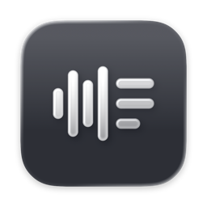

<p align="center">
  
</p>

<h1 align="center">Fundus</h1>

<p align="center">
  <strong>Your recordings, remembered.</strong>
</p>

<p align="center">
  <a href="docs/guide.md">Get started</a> ·
  <a href="#the-apps">The apps</a> ·
  <a href="#connect-your-ai">Connect your AI</a> ·
  <a href="docs/packaging.md">Build &amp; release</a>
</p>

<p align="center">
  <a href="LICENSE"></a>
  <a href="#the-apps"></a>
  <a href="#connect-your-ai"></a>
</p>

**Fundus** (German for “a collection to draw on,” pronounced [/ˈfʊndʊs/](https://de.wiktionary.org/wiki/Fundus)) is a self-hosted archive for your recordings. Import audio, keep the moments that matter, and come back to searchable transcripts, named speakers, and notes—with a direct link to the original conversation.

<br>

## From a recording to something you can find

| Capture | Understand | Return |
| :--- | :--- | :--- |
| Import from a recorder or folder. Preview, group, split, and trim sessions before uploading. | Get timestamped transcripts, speaker recognition, titles, and summaries. Correct names once and keep them consistent. | Search by words or meaning. Listen alongside the transcript, or ask an MCP-compatible AI for passages with audio citations. |

- **Keep the original.** Source files on your recorder are never changed. Integer PCM WAV up to 24 bits is converted to verified, lossless FLAC; float and 32-bit WAV pass through unchanged.
- **Pick up where you left off.** Resumable uploads and durable processing checkpoints preserve progress across interruptions. Playback becomes available while the rest of a recording is processing.
- **Keep your archive together.** Audio, transcripts, notes, labels, and voice profiles live on your server. SQLite handles storage and keyword search; no separate database or vector service is needed.
- **Choose your way in.** Use the native Mac app, the web library, mobile upload clients, or your preferred MCP-compatible AI.

## Get started

You’ll need Docker Compose, an HTTPS reverse proxy, and an AssemblyAI API key. An OpenAI API key enables titles, summaries, name evidence, and semantic search.

```sh
cp .env.example .env
# Set your public HTTPS URL, API keys, and recorder timezone in .env.

docker compose build
python3 -c 'import getpass; print(getpass.getpass("Fundus password: "))' \
  | docker compose run --rm -T server init
docker compose up -d
```

Open your public URL and sign in. The server listens on loopback port `3000`; your reverse proxy provides HTTPS. Use a password of at least 12 characters.

An existing authenticating proxy can provide the browser login instead. See the [server setup guide](docs/guide.md#run-the-server) for proxy authentication, the exact client routes to expose, environment variables, and running a local binary. For a published container image, see [packaging and releases](docs/packaging.md).

## The apps

### Mac

A SwiftUI app for macOS 15 and later, with recorder discovery, session preview, frame-based trimming, a transcript library, and a menu bar companion. Plug in a recorder, choose a session, and import it. Browse and listen while Fundus processes the recording.

Build with Xcode 26 or newer:

```sh
scripts/build-macos.sh
open build/Fundus.app
```

Connect your server in Settings and sign in through your browser. Saved connections stay in Keychain. Keep the same signing identity between builds to preserve Keychain access. [Mac setup and packaging →](docs/guide.md#upload-apps)

### Web

The server includes a Svelte library for playback, time-linked transcripts, search, labels, recording dates, and speaker corrections. No separate web deployment is required.

### iOS & Android

Expo apps with native SwiftUI and Jetpack Compose controls prepare audio and upload it in resumable chunks. They require a custom native build and an upload token from Fundus Settings. [Mobile build instructions →](docs/guide.md#upload-apps)

Physical recorder connectivity and background execution depend on the device and OS. See [verification notes](docs/verification.md) for current testing coverage.

## Connect your AI

Add your server’s MCP endpoint to a compatible chat app:

```text
https://your-vault.example/mcp
```

Sign in through your browser and approve read access. Fundus exposes five tools:

| Tool | What it gives your AI |
| :--- | :--- |
| `search` | Relevant passages, timestamps, citation links, and search coverage |
| `list_entries` | Recordings filtered by date, label, person, or processing status |
| `get_entries` | Recording metadata, summaries, source timelines, and speakers |
| `read_transcript` | Paginated transcript text with timestamps and speaker attribution |
| `list_labels` | Available labels and recording counts |

MCP connections are read-only. They cannot upload, edit, delete, or administer your archive. Revoke a connection at any time in Settings. [OAuth details and older clients →](docs/guide.md#mcp)

## Your archive, your server

Fundus keeps the archive on infrastructure you control. **Audio is sent to AssemblyAI for transcription; transcript and passage text are sent to OpenAI for notes and embeddings.** Speaker embeddings are computed locally. Self-hosting does not make every processing step local.

Provider models and API endpoints are configurable. There is no analytics SDK. Protect your disks and backups with your own encryption and access controls. [Processing and data handling →](docs/guide.md#pipeline-and-retrieval)

Backups include the SQLite database and audio archive. Stop the server before taking a backup, and keep its shutdown grace period long enough to save in-flight work. [Backup, restore, and deletion →](docs/guide.md#data-deletion-and-backup)

## Development

| Part | Built with |
| :--- | :--- |
| Server | Rust, Axum, SQLx, SQLite / FTS5 |
| Web library | Svelte, TypeScript, Vite |
| Mac app | SwiftUI, shared Swift audio and transfer code |
| Mobile upload apps | Expo, React Native, native platform controls |
| Speaker recognition | Local WeSpeaker ONNX model |

For the server and web app, install Rust 1.94+, Node 26, PNPM 10.34.5, and FFmpeg / ffprobe:

```sh
pnpm install --frozen-lockfile
pnpm build
cargo test --locked
```

Tests use local provider mocks and real audio tools, so they need no live API keys. See the [full checks](docs/guide.md#checks), [verification notes](docs/verification.md), and [release workflow](docs/packaging.md) before changing platform or deployment behavior.

## License

[MIT](LICENSE). Third-party components retain their respective licenses.
